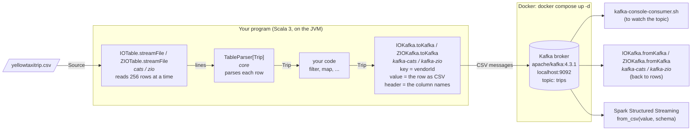
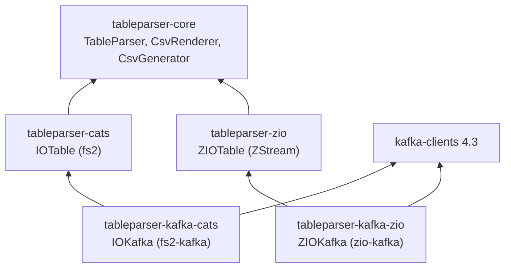

# From CSV to Kafka (and Spark)

This is a walk-through of the whole pipeline: a (possibly huge) CSV file is read as a stream, each row is parsed as
soon as it has been read, and each row is sent to a Kafka topic as one message, which a Spark job can then read.
The Kafka broker runs in Docker (`docker-compose.yml`, in the root of this repository).

The README's [Sending rows to Kafka](README.md#sending-rows-to-kafka) describes the API (`toKafka`, `toKafkaWith`,
the `tableparser.columns` header, reading the messages back, and testing without a broker); this page puts it to work.

## The architecture

Each box names the TableParser module (or library) which does that step.



The libraries underneath:



### What is in memory

The unit of the pipeline is a row: usually one line of the file, though in multiline mode a quoted field may span lines.
The source must be a stream, made by `IOTable.streamFile` (or `ZIOTable.streamFile`, or any of the other `stream` methods),
for memory to be _bounded_, whatever the size of the file:

* `IOTable` and `ZIOTable` read the rows in chunks of 256, and the Kafka pipes send a whole chunk at a time.
* The Kafka producer buffers the messages which it hasn't sent yet, up to its `buffer.memory` (32 MB by default).

So at any moment there are a few chunks of rows in the stream, and up to `buffer.memory` of messages in the producer
(when the buffer is full, sending waits). Parsing a `Table` and sending `Stream.emits(table.content.toSeq)` works,
but holds the whole table in memory, as does anything which needs every row at once, such as sorting.
(The `topN` pipes hold only n rows.)

## 1. Start the broker

You need Docker with its Compose plugin: Docker Desktop, or (on a Mac) `brew install colima docker docker-compose` and then `colima start`.
From the root of the repository:

```bash
docker compose up -d
```

If Docker Desktop was once installed and has since been replaced (by Colima, say), two leftovers can get in the way:
`docker compose` is "unknown" (the plugin in `~/.docker/cli-plugins` is a link into the old app: link it to Homebrew's
`docker-compose` instead), or the image can't be pulled because `docker-credential-desktop` isn't found
(delete the line `"credsStore": "desktop",` from `~/.docker/config.json`).

`docker ps` shows the `tableparser-kafka` container as `healthy` once the broker is ready (after ten seconds or so).
The broker listens on `localhost:9092`. Topics are created when they're first written to, but you can create one explicitly:

```bash
docker exec tableparser-kafka /opt/kafka/bin/kafka-topics.sh --bootstrap-server localhost:9092 --create --topic trips
```

The heart of `docker-compose.yml` is a single node which is both broker and controller (KRaft mode, so no ZooKeeper),
running the same version of Kafka as the client which the Kafka modules use:

```yaml
services:
  kafka:
    image: apache/kafka:4.3.1
    container_name: tableparser-kafka
    ports:
      - "9092:9092"
    environment:
      KAFKA_PROCESS_ROLES: broker,controller
      KAFKA_LISTENERS: PLAINTEXT://:9092,CONTROLLER://:9093
      KAFKA_ADVERTISED_LISTENERS: PLAINTEXT://localhost:9092
      # ... (one replica for each internal topic, since there's only one broker)
```

## 2. Define the rows

A row is a case class, with a parser (to read the file), a `CsvProduct` (to write each row, and its column names, as CSV)
and a `SparkSchema` (the schema with which Spark reads the messages: see step 6).
The file `yellowtaxitrip.csv` (in the root of this repository) has a thousand taxi trips, with nineteen columns,
and a space after each comma. This takes eight of the columns, and ignores the others.
The times, such as `2024-01-01T00:34:44Z`, are `Instant`s (from 2.5.0, the `java.time` types parse and render as ISO-8601):

```scala
import com.phasmidsoftware.tableparser.core.parse.ColumnHelper.camelToSnakeCaseColumnNameMapperLower
import com.phasmidsoftware.tableparser.core.parse.*
import com.phasmidsoftware.tableparser.core.render.{CsvProduct, SparkSchema}
import java.time.Instant

case class Trip(vendorId: Int, pickup: Instant, dropoff: Instant, passengerCount: Int, tripDistance: Double, fareAmount: Double, tipAmount: Double, totalAmount: Double) derives CsvProduct, SparkSchema

object Trip extends CellParsers:
  given RowConfig = RowConfig.trimmingRowConfig // the space after each comma
  given ColumnHelper[Trip] = columnHelper(
    camelToSnakeCaseColumnNameMapperLower
    , "vendorId" -> "VendorID"
    , "pickup" -> "tpep_pickup_datetime"
    , "dropoff" -> "tpep_dropoff_datetime"
  )
  given CellParser[Trip] = CellParser.derived[Trip]
  given StringParser[Trip] = StandardRowParser.create[Trip]

object TripTableParser extends HeadedCSVTableParser[Trip]
```

## 3. Stream the file to Kafka

With fs2 (`tableparser-kafka-cats`):

```scala
import cats.effect.IO
import com.phasmidsoftware.tableparser.cats.table.IOTable
import com.phasmidsoftware.tableparser.kafka.cats.IOKafka
import fs2.kafka.ProducerSettings
import java.nio.file.Paths

val settings = ProducerSettings[IO, String, String].withBootstrapServers("localhost:9092")

val sent: IO[Int] =
  IOTable.streamFile(TripTableParser)(Paths.get("yellowtaxitrip.csv")) // Stream[IO, Trip], parsed as the file is read
    .through(IOKafka.toKafka("trips", settings)(_.vendorId.toString)) // one CSV message per Trip, keyed by its vendor
    .map(_.size)                                                        // each ProducerResult is a chunk of messages
    .compile.foldMonoid
```

Or with ZIO (`tableparser-kafka-zio`):

```scala
import com.phasmidsoftware.tableparser.kafka.zio.ZIOKafka
import com.phasmidsoftware.tableparser.zio.table.ZIOTable
import zio.ZLayer
import zio.kafka.producer.{Producer, ProducerSettings}
import zio.kafka.serde.Serde

val producer = ZLayer.scoped(Producer.make(ProducerSettings(List("localhost:9092"))))

val sent = ZIOTable.streamFile(TripTableParser)(Paths.get("yellowtaxitrip.csv"))
  .via(ZIOKafka.toKafka("trips", Serde.string)(_.vendorId.toString)) // emits each message's RecordMetadata
  .runCount
  .provideLayer(producer)
```

The fs2 version, ready to run, is `kafka-cats/src/test/scala/.../kafka/cats/TripsToKafka.scala`.
With the broker running, from the root of the repository:

```bash
sbt "kafkaCats/Test/runMain com.phasmidsoftware.tableparser.kafka.cats.sendTrips"
```

It sends the thousand trips of `yellowtaxitrip.csv`, says how many messages Kafka acknowledged
(after the Kafka client has logged its configuration, and perhaps warned that the topic didn't exist yet),
and prints the Spark schema of the messages (step 6):

```text
Sent 1000 messages from yellowtaxitrip.csv to topic trips at localhost:9092
Spark schema: `VendorID` INT, `tpep_pickup_datetime` TIMESTAMP, `tpep_dropoff_datetime` TIMESTAMP, `passenger_count` INT, `trip_distance` DOUBLE, `fare_amount` DOUBLE, `tip_amount` DOUBLE, `total_amount` DOUBLE
```

Give it another file of taxi trips (and, optionally, other bootstrap servers and another topic) as arguments:

```bash
sbt "kafkaCats/Test/runMain com.phasmidsoftware.tableparser.kafka.cats.sendTrips path/to/trips.csv localhost:9092 trips"
```

## 4. Watch the topic

The column names are in each message's record header, so ask the console consumer to print the headers as well as the key:

```bash
docker exec tableparser-kafka /opt/kafka/bin/kafka-console-consumer.sh --bootstrap-server localhost:9092 --topic trips --from-beginning --formatter-property print.key=true --formatter-property print.headers=true
```

Each message is the header, the key (the vendor) and one line of CSV:

```text
tableparser.columns:VendorID,tpep_pickup_datetime,tpep_dropoff_datetime,passenger_count,trip_distance,fare_amount,tip_amount,total_amount	2	2,2024-01-01T00:34:44Z,2024-01-01T00:40:55Z,1,1.76,10.0,4.5,19.5
```

The column names are those of the original file, for the columns which `Trip` keeps: `CsvGenerator` uses the given `ColumnHelper`.
Each row's message is written without the space after each comma, as plain RFC 4180 CSV.

## 5. Read the topic back, as rows

`fromKafka` is the mirror of `toKafka`: it reads a topic as a stream of rows, parsing each message's value
with the column names in its `tableparser.columns` header, and the same parser that read the file
(so its predicates and forgiving mode apply). With fs2 (`tableparser-kafka-cats`):

```scala
import fs2.kafka.{AutoOffsetReset, ConsumerSettings}

val consumer = ConsumerSettings[IO, String, String]
  .withBootstrapServers("localhost:9092")
  .withGroupId("readTrips")
  .withAutoOffsetReset(AutoOffsetReset.Earliest)

val first: IO[List[Trip]] = IOKafka.fromKafka("trips", consumer)(TripTableParser).take(5).compile.toList
```

Or with ZIO (`tableparser-kafka-zio`), with a zio-kafka `Consumer` in the environment:

```scala
import zio.kafka.consumer.{Consumer, ConsumerSettings}

val consumer = ZLayer.scoped(Consumer.make(ConsumerSettings(List("localhost:9092")).withGroupId("readTrips")
  .withOffsetRetrieval(Consumer.OffsetRetrieval.Auto(Consumer.AutoOffsetStrategy.Earliest))))

val first = ZIOKafka.fromKafka("trips", Serde.string)(TripTableParser).take(5).runCollect.provideLayer(consumer)
```

`fromKafka` commits the offsets a chunk at a time, once the chunk's rows have been emitted (at-least-once):
if the stream fails, or stops part-way through a chunk (as `take(5)` does), those rows are read again next time.
To commit only once you've processed each row, use `fromKafkaCommittable`, which gives each row with its offset.
(`fromKafkaWith` reads messages of any other form, such as JSON, with a function to decode each one.)

The fs2 version is ready to run, too:

```bash
sbt "kafkaCats/Test/runMain com.phasmidsoftware.tableparser.kafka.cats.readTrips"
```

It prints the first five trips (and takes the number, the bootstrap servers, the topic and the group as optional arguments):

```text
Trip(2,2024-01-01T00:34:44Z,2024-01-01T00:40:55Z,1,1.76,10.0,4.5,19.5)
```

## 6. Read the topic with Spark

Spark (Scala 2.13, or PySpark) parses each CSV message with `from_csv` and a schema which matches the header.
`from_csv` takes the columns by position, not by name, so the schema must list them in the order of the header.
`SparkSchema.ddl[Trip]` derives it from the same `ColumnHelper` and field order as the `tableparser.columns` header,
so the two can't disagree (it's a `Try`: a `Failure` if the numbers of names and types differ):

```scala
SparkSchema.ddl[Trip]
// Success(`VendorID` INT, `tpep_pickup_datetime` TIMESTAMP, `tpep_dropoff_datetime` TIMESTAMP, `passenger_count` INT, ...)
```

A field's Spark type comes from its `SparkType`: for example, `Instant` is `TIMESTAMP` and `LocalDateTime` is `TIMESTAMP_NTZ`.
Give a `SparkType` of your own for another field type. Spark isn't a dependency of TableParser (it isn't published for Scala 3):
the schema is a string, which the Spark job uses as it is (here, pasted in from what `sendTrips` printed):

```scala
// In the Spark job (with the spark-sql-kafka-0-10 package).
import org.apache.spark.sql.functions.{col, from_csv}
import org.apache.spark.sql.types.StructType

// In Scala, from_csv takes a StructType (unlike from_json, which also takes the DDL string itself).
val schema = StructType.fromDDL("`VendorID` INT, `tpep_pickup_datetime` TIMESTAMP, `tpep_dropoff_datetime` TIMESTAMP, `passenger_count` INT, `trip_distance` DOUBLE, `fare_amount` DOUBLE, `tip_amount` DOUBLE, `total_amount` DOUBLE")
val trips = spark.readStream.format("kafka")
  .option("kafka.bootstrap.servers", "localhost:9092")
  .option("subscribe", "trips")
  .option("startingOffsets", "earliest")
  .load()
  .select(from_csv(col("value").cast("string"), schema, Map.empty[String, String]).as("trip"))
  .select("trip.*")
```

For a first try, `spark.read` (with the same options and the same _select_) reads what is in the topic and stops,
so `trips.show()` prints the first trips, with the times as timestamps.

The topic may still hold messages from an older version of the producer, with other columns.
To check each message at run time, read the headers too (`.option("includeHeaders", "true")`)
and compare its `tableparser.columns` header with the schema's names.

Alternatively, send JSON: `toKafkaWith` with a circe `Encoder` (see [JSON messages](README.md#json-messages)),
and `from_json` with the same schema in Spark. JSON repeats the field names in every message, but its fields are
matched by name, not by position, and it has no header to print.

## 7. Stop the broker

```bash
docker compose down
```

The topics (and their messages) go with the container.

## Without Docker

The integration tests (`sbt integration/test`) start a broker inside the JVM instead (embedded-kafka):
see `IOKafkaBrokerSpec` and `ZIOKafkaBrokerSpec`.
